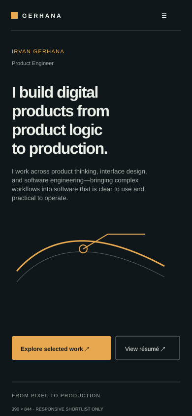
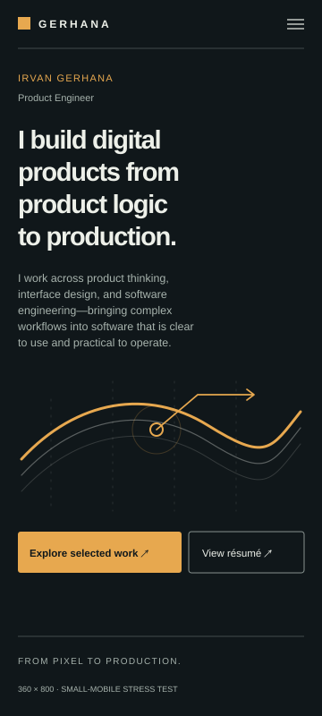
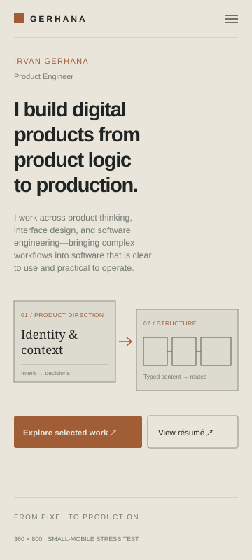
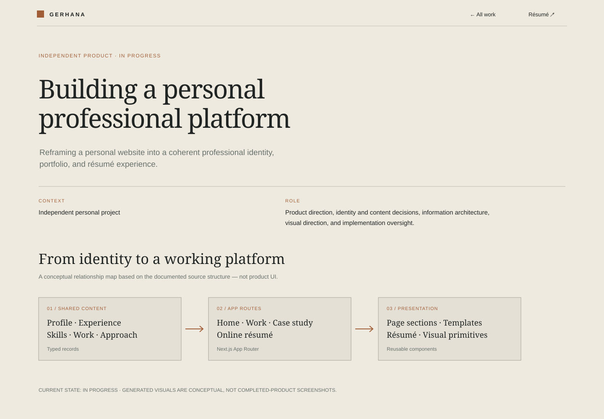

# Phase 2 — Visual review board

A single review surface for the non-binding static concepts.

> **Owner decision — 2026-11-27:** A — The System Atlas was selected for focused art-direction refinement. See the [refined System Atlas board](../system-atlas/README.md). The four concepts below remain available as the original comparison archive; they are not competing current directions. Desktop previews use the same 1440 × 900 source frame and are displayed at the same 640 px width. Each image links to its original editable SVG; open the source when you need to inspect detail at native size.

**Review order:** desktop A → B → C → D, then the responsive A/D pairs. Compare the message hierarchy and visual idea, not the amount of decoration. No concept is selected or approved by this page.

## Desktop — equal-size comparison

<table>
  <thead>
    <tr>
      <th scope="col">A — The System Atlas</th>
      <th scope="col">B — The Editorial Instrument</th>
    </tr>
  </thead>
  <tbody>
    <tr>
      <td></td>
      <td></td>
    </tr>
    <tr>
      <th scope="col">C — Material to Meaning</th>
      <th scope="col">D — The Product Field Notes</th>
    </tr>
    <tr>
      <td></td>
      <td></td>
    </tr>
  </tbody>
</table>

## Responsive shortlist — primary mobile, 390 × 844

<table>
  <thead>
    <tr>
      <th scope="col">A — The System Atlas</th>
      <th scope="col">D — The Product Field Notes</th>
    </tr>
  </thead>
  <tbody>
    <tr>
      <td></td>
      <td></td>
    </tr>
  </tbody>
</table>

## Responsive stress test — small mobile, 360 × 800

<table>
  <thead>
    <tr>
      <th scope="col">A — The System Atlas</th>
      <th scope="col">D — The Product Field Notes</th>
    </tr>
  </thead>
  <tbody>
    <tr>
      <td></td>
      <td></td>
    </tr>
  </tbody>
</table>

## Case-study extension

[Open the original case-study extension SVG](case-study-extension-test.svg).

## How to review

1. Start with the four desktop frames. The source artwork is unchanged; each preview is scaled proportionally to the same displayed width.
2. Check the shared identity, role, headline, introduction and both actions before judging the visual metaphor.
3. Compare A and D at both mobile widths. Treat 360 × 800 as a static stress point, not evidence of actual-device, browser-zoom or OS text-scaling coverage.
4. Record feedback in the [owner review checklist](OWNER-REVIEW-CHECKLIST.md). The qualitative weighted scores in the [phase README](README.md) are prompts, not a winner selector.

## Decision and evidence boundary

- The four directions and A/D responsive shortlist remain non-binding research.
- This page does not approve a permanent typeface, palette, token system, illustration/material treatment, or motion language.
- All visible artwork is drawn from the original source SVGs. No project screenshots, customer claims, metrics, outcomes, or unapproved content are added.
- This page does not change or close Phase 1 and does not authorize production implementation.
