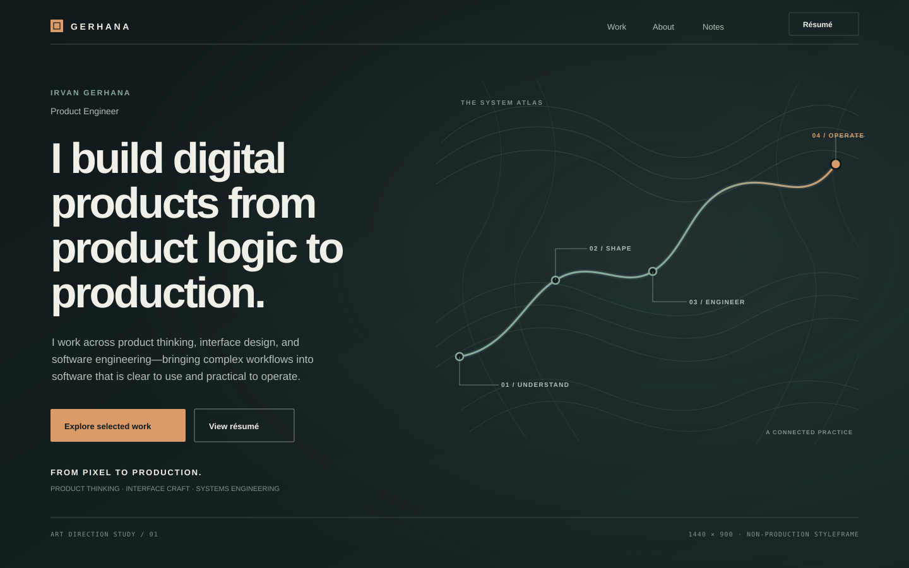
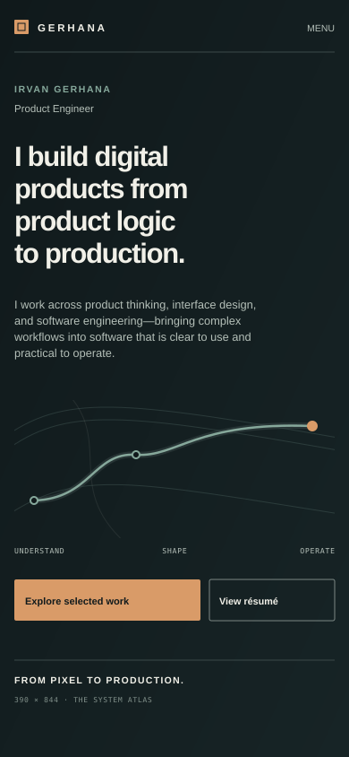
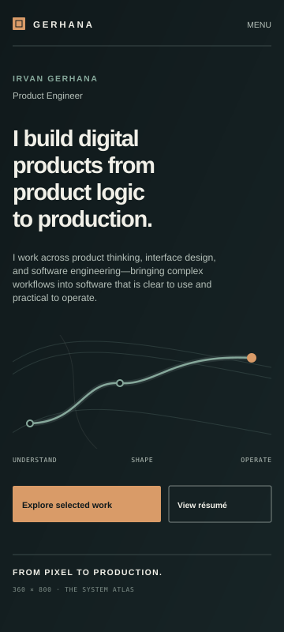

# The System Atlas — refined art direction preview

**Owner-selected direction · refinement for review**

The System Atlas is the selected concept to refine. This is a new art-direction pass, not a replacement for the four-concept research archive.

## Desktop — 1440 × 900

[Open editable desktop SVG](./desktop.svg)

## Mobile — 390 × 844

[Open editable mobile SVG](./mobile.svg)

## Small mobile — 360 × 800

[Open editable small-mobile SVG](./small-mobile.svg)

## Connected full-page styleframes

The Phase 5 package extends System Atlas through the full homepage journey and supporting routes.

[Open connected desktop/tablet/mobile, work index, case study, résumé, motion storyboard, and QA notes](./connected/README.md).

## Direction decisions

- **Typography:** Manrope for display and headings; Plus Jakarta Sans for body and interface.
- **Palette:** Basalt / Limestone / Sea Glass / Signal Copper.
- **Motion:** GSAP, with one continuous route-draw sequence and intentional reduced-motion state.
- **Gutter:** `1rem` base gutter.
- **Inset:** component-scoped `--py` and `--px` pairs, using rem values.

[Read the complete art-direction specification](../../design-system/SYSTEM-ATLAS-ART-DIRECTION.md).

**Review status:** owner-selected direction, refinement pending visual acceptance. These remain static design studies. No production UI, final token freeze, or site-wide implementation is included.
