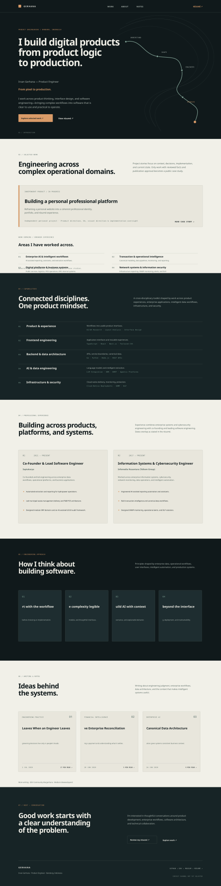
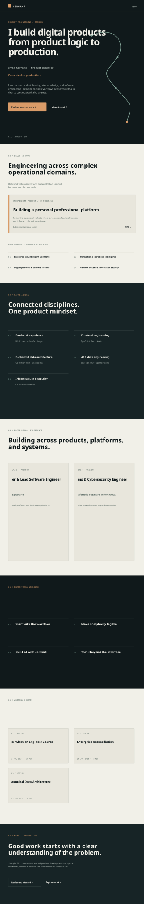
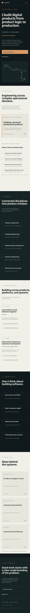
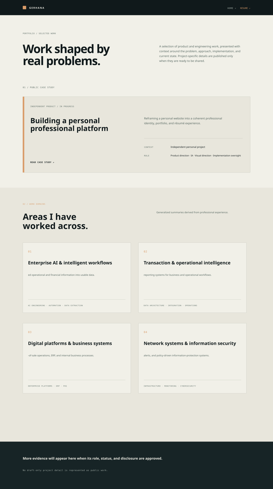
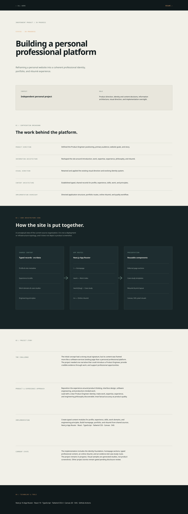
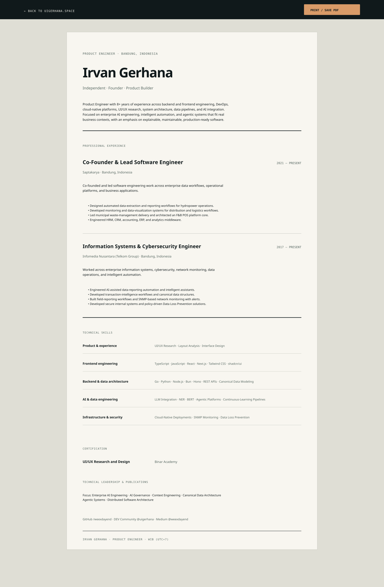
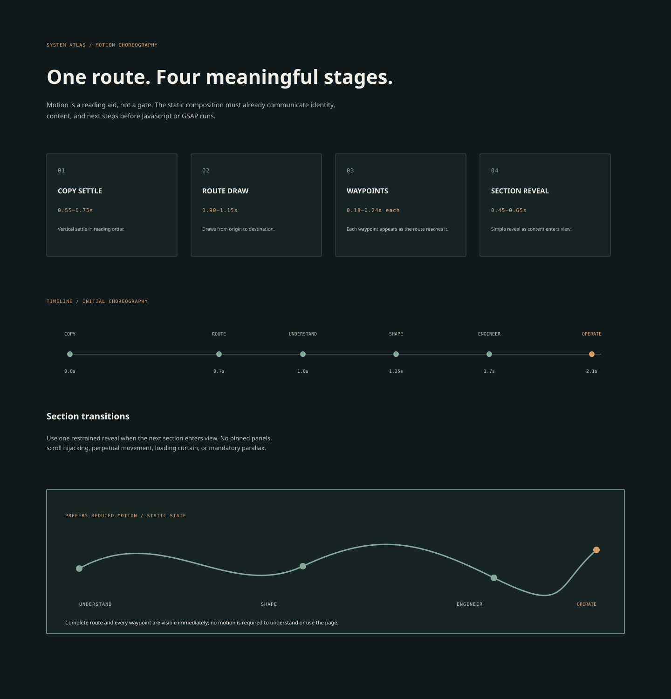

# The System Atlas — Phase 5 connected styleframes

**Status:** Initial connected styleframe package prepared for owner review · 2026-11-27  
**Direction:** Owner-selected System Atlas · Manrope + Plus Jakarta Sans · GSAP  
**Review state:** Not approved for production implementation

This package tests the visual direction across a complete visitor journey rather than treating the hero as the whole identity. It is a set of editable static SVG studies, not browser screenshots or implemented UI.

## Homepage journey

The connected homepage preserves the actual section sequence and public content structure:

1. Introduction — identity, positioning, approved headline and introduction, primary and secondary CTA.
2. Selected work — one public case study, explicitly marked **In progress**, followed by four generalized work domains.
3. Capabilities — five source-backed capability groups.
4. Professional experience — the two roles and overlapping periods stated in the résumé.
5. Engineering approach — four established engineering principles.
6. Writing — three existing public articles with their publication dates and reading times.
7. Contact — existing résumé/work destinations and public profiles; no invented email address or direct contact channel.

### Responsive homepage frames

**Desktop · 1440 × 5740**

[Open editable desktop SVG](./home-desktop.svg)

**Tablet · 834 × 5200**

[Open editable tablet SVG](./home-tablet.svg)

**Mobile · 390 × 7850**

[Open editable mobile SVG](./home-mobile.svg)

## Route and content-page examples

**Work index · 1440 × 2580**

[Open editable work-index SVG](./work-index.svg)

**Case study detail · 1440 × 3920**

[Open editable case-study SVG](./case-study.svg)

The case-study example is limited to the currently approved public project, UI Gerhana. It remains labelled *In progress*. Its architecture diagram is a conceptual source/code-architecture view, not a deployment topology or product screenshot.

**Résumé · 1440 × 2200**

[Open editable résumé SVG](./resume.svg)

The résumé study uses only existing résumé-backed role, skill, certification, and publication details. No phone number, email address, education history, or language proficiency is invented.

## Reusable visual system

The next System Atlas bake adds a component and interaction-state proposal that can be reviewed alongside these connected page frames.

- [Component system and anatomy](../../../design-system/SYSTEM-ATLAS-COMPONENT-SYSTEM.md)
- [Semantic token proposal](../../../design-system/SYSTEM-ATLAS-TOKEN-PROPOSAL.md)
- [Interaction-state contract](../../../design-system/SYSTEM-ATLAS-INTERACTION-STATES.md)
- [Component library visual board](./component-library.svg)

The examples are reusable design contracts, not implemented components. Final token freeze and state-specific browser validation remain open.

## Responsive component and interaction specimens

- [Desktop interaction-state board](./interaction-states-desktop.svg)
- [Mobile navigation and component specimen](./interaction-states-mobile.svg)
- [Surface-specific contrast and responsive review](./STATE-AND-RESPONSIVE-REVIEW.md)
- [Static SVG copy-integrity review](./COPY-INTEGRITY-REVIEW.md)
- [Browser font-rendering review](./FONT-RENDERING-REVIEW.md)
- [Responsive acceptance matrix — viewport samples, behaviors, failure criteria, and test register](./RESPONSIVE-ACCEPTANCE-MATRIX.md)
- [Interaction-state contract](../../../design-system/SYSTEM-ATLAS-INTERACTION-STATES.md)

These boards are static design proposals. Focus, hover, pressed, disabled, and mobile disclosure states still require real-browser validation after a separately approved implementation.

## Motion and interaction direction

[Open editable motion storyboard SVG](./motion-storyboard.svg)

[Motion storyboard and GSAP implementation constraints](./MOTION-STORYBOARD.md)

The static route and every waypoint remain visible without JavaScript. Reduced motion removes the route draw, stagger, translation, and scroll-triggered movement; it does not hide content.

## Review notes

- [Design QA and owner review checklist](./DESIGN-QA.md)
- [Static artboard visual review — corrected layout findings and browser evidence](./VISUAL-REVIEW.md)
- [Content provenance and disclosure boundaries](./CONTENT-PROVENANCE.md)
- [System Atlas visual-system proposal](../../../design-system/SYSTEM-ATLAS-ART-DIRECTION.md)
- [Brand identity roadmap](../../../BRAND-IDENTITY-PLAN.md)

## What this package does not approve

- Final palette-role/token freeze or contrast sign-off for every rendered state.
- Final font metrics, responsive type scale, or real-font browser rendering.
- Public copy changes or new professional claims.
- Publication of draft project records, private client details, metrics, screenshots, or testimonials.
- A direct contact channel.
- Production UI, application CSS, routes, dependency changes, site-wide integration, or deployment.

The SVGs declare Manrope and Plus Jakarta Sans but do not embed font files. Real font loading, text wrapping, zoom, OS text scaling, and browser rendering require a later browser-based review. This package does not close the remaining Phase 1 gates.
